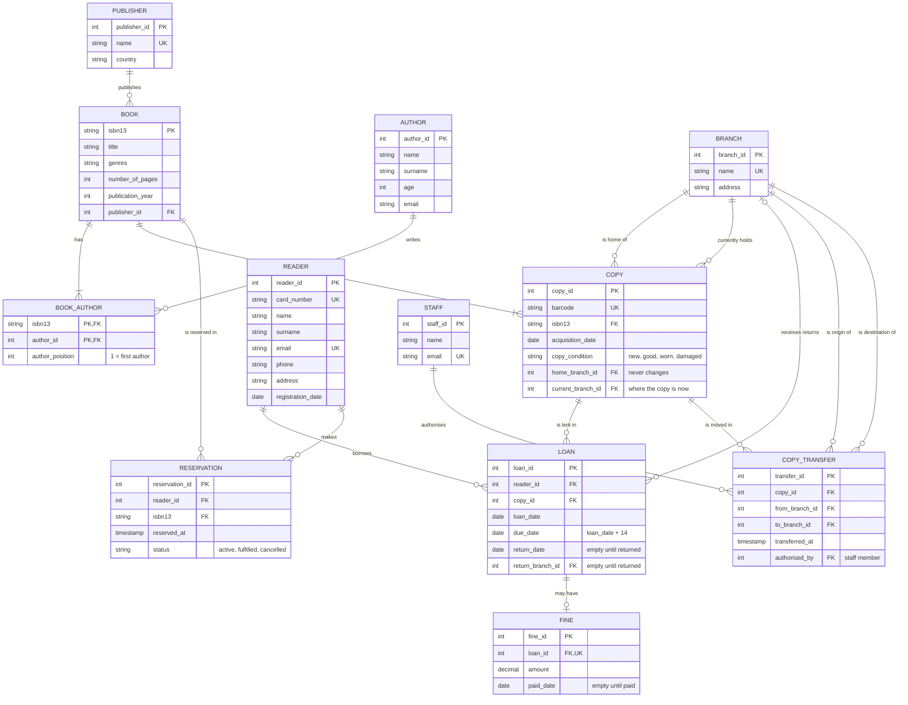

# Challenge 02: Branches, transfers and BCNF

This builds on the exercise model. The tables not mentioned here (reader, publisher, book, author, book_author, reservation, fine) stay the same.

## 1. Extended model



### New and changed tables

| Table | Columns | Primary key | Foreign keys | UNIQUE |
|---|---|---|---|---|
| branch (new) | branch_id, name, address | branch_id | none | name |
| staff (new) | staff_id, name, email | staff_id | none | email |
| copy (changed) | copy_id, barcode, isbn13, acquisition_date, copy_condition, **home_branch_id**, **current_branch_id** | copy_id | isbn13 → book, home_branch_id → branch, current_branch_id → branch | barcode |
| loan (changed) | loan_id, reader_id, copy_id, loan_date, return_date, **return_branch_id** | loan_id | reader_id → reader, copy_id → copy, return_branch_id → branch | copy_id, only where return_date is empty |
| copy_transfer (new) | transfer_id, copy_id, from_branch_id, to_branch_id, transferred_at, authorised_by | transfer_id | copy_id → copy, from_branch_id → branch, to_branch_id → branch, authorised_by → staff | (copy_id, transferred_at) |

Details:

- `current_branch_id` starts equal to `home_branch_id`. It changes only when a transfer is added.
- `copy_transfer` has `CHECK (from_branch_id <> to_branch_id)`. Rows are only added, never changed or deleted, so every transfer is kept.
- `loan` has `CHECK ((return_date IS NULL) = (return_branch_id IS NULL))`: a return always has both a date and a branch.
- If a copy is returned at a different branch than the one it left from, a transfer row is added (from the branch it left, to the return branch, authorised by the staff member who checked it in). That way the history also shows moves caused by returns.

### Finding the current location

The current location is in `copy.current_branch_id`, so "where is copy X?" reads one row and not the history. This repeats information that is also in `copy_transfer`, so a trigger must update it every time a transfer is inserted.

Rules for the triggers:

- A new transfer must start at the copy's `current_branch_id`.
- After inserting a transfer, set `copy.current_branch_id` to `to_branch_id`.
- A copy with an open loan can't be transferred (it is with the reader).

## 2. Two queries

**Where is copy X now?**
Tables: `copy` (find the barcode and read `current_branch_id`) and `branch` (the name). To know if it is on loan, also look at `loan` for an open loan on that copy. `copy_transfer` is not needed.

```sql
SELECT b.name
FROM copy c
JOIN branch b ON b.branch_id = c.current_branch_id
WHERE c.barcode = :barcode;
```

**Which copies left branch Y last month?**
Tables: `copy_transfer` (rows with `from_branch_id = Y` and a date in last month), then `copy` and `book` for the barcode and title, and `branch` for where they went.

```sql
SELECT c.barcode, bk.title, t.transferred_at, tb.name AS moved_to
FROM copy_transfer t
JOIN copy c ON c.copy_id = t.copy_id
JOIN book bk ON bk.isbn13 = c.isbn13
JOIN branch tb ON tb.branch_id = t.to_branch_id
WHERE t.from_branch_id = :branch_y
  AND t.transferred_at >= date_trunc('month', now()) - interval '1 month'
  AND t.transferred_at <  date_trunc('month', now());
```

(I haven't run these against a database.)

## 3. 3NF and BCNF

**Difference.** For a dependency X → A:

- 3NF allows it if X is a key, or if A is part of some candidate key.
- BCNF allows it only if X is a key.

So BCNF is stricter. A table can be in 3NF and not in BCNF only when it has overlapping candidate keys made of several columns.

**Example (not in my model).** Imagine a table `reader_librarian(reader_id, branch_id, staff_id)` where each reader has one librarian per branch, and each librarian works at one branch.

- Dependencies: (reader_id, branch_id) → staff_id, and staff_id → branch_id.
- Candidate keys: (reader_id, branch_id) and (reader_id, staff_id).
- It is in 3NF: in staff_id → branch_id, staff_id is not a key, but branch_id is part of a candidate key.
- It is not in BCNF: staff_id is not a key.
- Problem: if a librarian changes branch, many rows must be updated.
- Fix: split into `staff(staff_id, branch_id)` and `reader_librarian(reader_id, staff_id)`.

**My model.** I did not find a table that is in 3NF but not in BCNF. In every table, each dependency starts from a key:

| Table | Candidate keys | Dependencies |
|---|---|---|
| reader | reader_id, card_number, email | each key → all other columns |
| publisher | publisher_id, name | each key → the other columns |
| author | author_id | author_id → name, surname, age, email |
| book | isbn13 | isbn13 → title, genres, number_of_pages, publication_year, publisher_id |
| book_author | (isbn13, author_id), (isbn13, author_position) | (isbn13, author_id) → author_position, and (isbn13, author_position) → author_id |
| branch | branch_id, name | each key → the other columns |
| staff | staff_id, email | each key → the other columns |
| copy | copy_id, barcode | each key → all other columns |
| loan | loan_id | loan_id → all other columns |
| copy_transfer | transfer_id, (copy_id, transferred_at) | each key → all other columns |
| reservation | reservation_id | reservation_id → all other columns |
| fine | fine_id, loan_id | each key → the other columns |

`book_author` is the closest one because it has two overlapping keys, but both determinants in it are keys, so it is in BCNF.