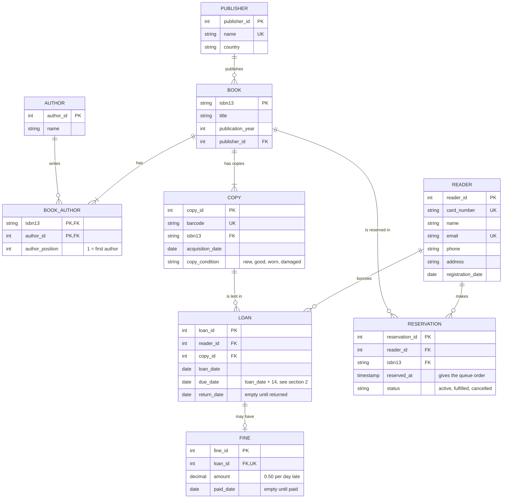

# Exercise 02: Library model

## 1. ER diagram

Cardinalities:

- A publisher has many books. A book has exactly one publisher.
- A book has one or more authors and an author can have many books (N:N), so `book_author` sits between them. It stores the author order in `author_position`.
- A book has one or more copies.
- A reader has many loans. A copy has many loans over time, but only one open at a time.
- A reader has many reservations. A reservation is for a book, not a copy.
- A loan has zero or one fine. A fine belongs to exactly one loan.

## 2. Tables in 3NF

| Table | Columns | Primary key | Foreign keys | UNIQUE |
|---|---|---|---|---|
| reader | reader_id, card_number, name, email, phone, address, registration_date | reader_id | none | card_number, email |
| publisher | publisher_id, name, country | publisher_id | none | name |
| book | isbn13, title, publication_year, publisher_id | isbn13 | publisher_id → publisher | none besides the PK |
| author | author_id, name | author_id | none | none (two authors can have the same name) |
| book_author | isbn13, author_id, author_position | (isbn13, author_id) | isbn13 → book, author_id → author | (isbn13, author_position) |
| copy | copy_id, barcode, isbn13, acquisition_date, copy_condition | copy_id | isbn13 → book | barcode |
| loan | loan_id, reader_id, copy_id, loan_date, return_date | loan_id | reader_id → reader, copy_id → copy | copy_id, only where return_date is empty |
| reservation | reservation_id, reader_id, isbn13, reserved_at, status | reservation_id | reader_id → reader, isbn13 → book | none |
| fine | fine_id, loan_id, amount, paid_date | fine_id | loan_id → loan | loan_id |

Notes:

- `copy_condition` has a CHECK: `new`, `good`, `worn` or `damaged`. `status` in reservation also has a CHECK: `active`, `fulfilled` or `cancelled`.
- `return_date` and `paid_date` are NULL until they happen.
- The reservation queue for a book is its active reservations ordered by `reserved_at`.
- `due_date` is not a column of `loan`. It is always `loan_date + 14`, so storing it would make a column depend on another non-key column (`loan_id → loan_date → due_date`), and that breaks 3NF. A view gives it when needed: `SELECT *, loan_date + 14 AS due_date FROM loan`.
- The publisher's country is in `publisher` and not in `book`, for the same reason.

## 3. Rules the tables cannot enforce alone

| Rule | Where | How |
|---|---|---|
| A copy is in at most one open loan | Constraint | Unique index on `loan(copy_id)` where `return_date IS NULL` |
| A reader has at most 5 open loans | Trigger | Before inserting a loan, count the reader's open loans and reject if there are already 5 |
| Return date is not before loan date | Constraint | `CHECK (return_date >= loan_date)` |
| A book has at least one author, and positions are 1, 2, 3... | Trigger | Check when the transaction commits. The UNIQUE on position stops duplicates but not gaps. |
| Each book has at least one copy | Application | Create the book and its first copy in the same transaction |
| A reservation is only allowed when no copy is available | Trigger | Before inserting, reject if some copy of the book has no open loan |
| Reservations are served in the order made | Application | When a copy comes back, take the oldest active reservation for that book and mark it `fulfilled` |
| A late return creates a fine of 0.50 per day late | Trigger | When `return_date` is set and is later than `loan_date + 14`, insert a fine with `0.50 * days late` |
| A fine can't be paid before the return | Trigger | Needs data from two tables, so a CHECK can't do it |

## 4. Denormalisation

I would store `due_date` in `loan` (with `CHECK (due_date = loan_date + 14)`).

Reason: if the library changes the loan period later, old loans should keep the due date they had, and late fines for them stay correct. It also makes the "overdue loans" query simpler and lets it use an index.

The price is one repeated value. I would not add other copies of data, like a loan counter on the reader or an "available" flag on the copy. They need triggers to stay correct, and a municipal library is small enough to just count.